# RISKYMSX

The RISKYMSX cartridge by Arkadiusz Makarenko is a compact MSX flash ROM cartridge based on the inexpensive CH32V30xVCT6 RISC-V MCU which can be easily programmed from a MSX computer using a FAT formatted USB pen drive containing ROM files.

[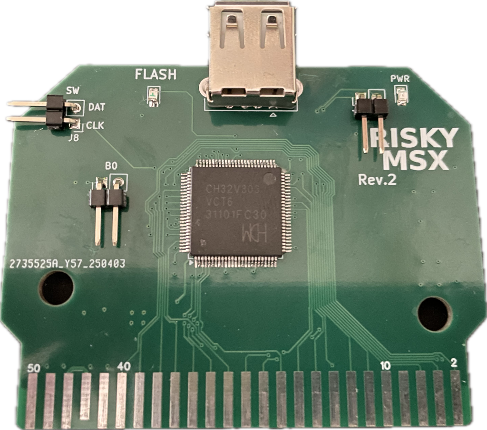](images/RISKYMSXCart-Rev2.1-front-populated-1024px.png)


## Main Features

* Support for up to 256KB ROMs
* SCC emulation
* Nextor 3.0 USB disk support for MSX-DOS programs and files
* Firmware programming with a WCH-LinkE; an experimental custom bootloader can update firmware from a USB stick
* ROM Flashing:
  * No external flash programmer is needed
  * A ROM can be flashed in-system using a MSX computer and a FAT-formatted USB pen drive
  * `ROM Flashing Mode` is activated by pressing GRAPH key during MSX boot
  * Automatic flashing of ROMs from USB can be achieved via specially named ROM archives
  * Manually flashing of ROMs from USB is done using a simple interactive menu
  * Automatic mapper type detection from the ROM content when flashing manually (same heuristic as openMSX)
  * FAT long filenames are supported
* Supported mappers:
  * Standard 16KB ROMs
  * Standard 32KB ROMs
  * Standard 48KB /64KB ROMs
  * KONAMI without SCC
  * KONAMI with SCC (EN - SCC emulation enabled)
  * KONAMI with SCC (DIS - SCC emulation disabled)
  * ASCII 8K
  * ASCII 16K
  * Neo 8k
  * Neo 16k


## Hardware

The RISKYMSX cartridge is made up of a 4-layer PCB with a reduced set of SMD components and through-hole connectors:
* A WCH [CH32V303VCT6](https://www.wch-ic.com/products/CH32V303.html) MCU (or alternatively a [CH32V307VCT6](https://www.wch-ic.com/products/CH32V307.html))
* Two LEDs, one to indicate power on state, and one lit during `ROM Flashing Mode`
* On rev 2.2, a CH217K current-limited switch controls power to the USB host port
* A [LM1117](https://www.ti.com/lit/ds/symlink/lm1117.pdf) voltage regulator to provide +3V3 to the MCU from the +5V rail of the MSX cartridge slot
* A [MCP6001](https://ww1.microchip.com/downloads/aemDocuments/documents/MSLD/ProductDocuments/DataSheets/MCP6001-1R-1U-2-4-1-MHz-Low-Power-Op-Amp-DS20001733L.pdf) operational amplifier to enhance the SCC audio signal fed into the MSX cartridge SOUNDIN pin
* Three headers:
  * B0: open for normal operation; closed to select system boot, including the optional custom bootloader
  * DAT/CLK: unconnected by default, used to program the MCU using the [`WCH-LinkE`](https://www.wch-ic.com/products/WCH-Link.html) programmer via SWDIO/SWCLK
  * RX/TX: unconnected by default, serial debug console
* One USB Type-A female connector
* Several passives required for proper operation of the above components

### Revisions

There are several hardware revisions of the cartridge. The main ones are listed here in reverse chronological order.

#### Rev 2.2 (current)

Rev 2.2 adds a CH217K switch to the USB host port. Its active-low enable is
controlled by PB12 and its fault output is connected to PB13. The USB port is
intended to power a USB drive, not to power the cartridge from a PC. Use
firmware that supports this switch.

The [schematic and PCB](board/), [rev 2.2 Gerbers](board/gerbers/RISKYMSXv22.zip),
and [schematic BOM](RISKYMSXCart.csv) are in this repository. The BOM requires
verification before ordering or assembly.

#### Rev 2.1 (older)

This version introduces the following changes:
* the flash button is removed, as the flashing interface can be accessed by pressing the GRAPH key on the MSX keyboard during boot
* unnecessary leds are removed, leaving just the Flash and Power leds
* the audio amplifier circuit is enhanced with a low pass filter 

[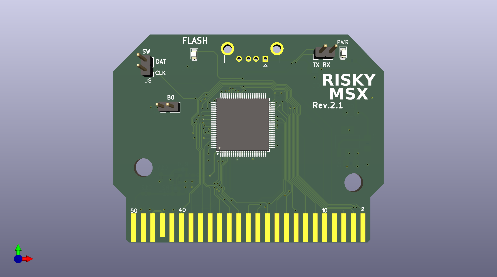](images/RISKYMSXCart-Rev2.1-front-render.png)
[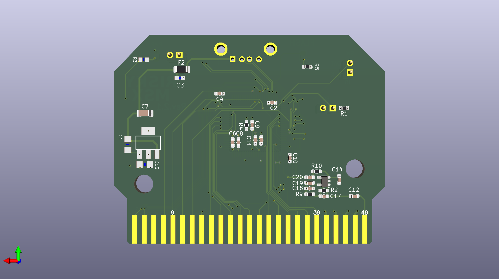](images/RISKYMSXCart-Rev2.1-back-render.png)

#### Rev 2 (obsolete)

This version introduces the following changes:
* the LM1117 voltage regulator and related passives are moved to the back of the PCB
* the B1 header is removed as it has no practical use
* a simple audio amplifier circuit is added for SCC sound

[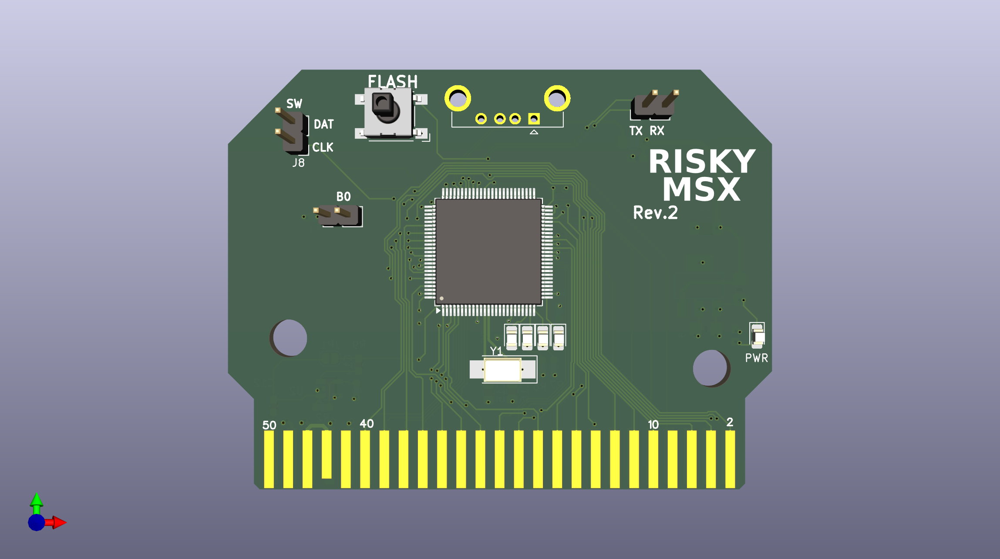](images/RISKYMSXCart-Rev2-front-render.png)|[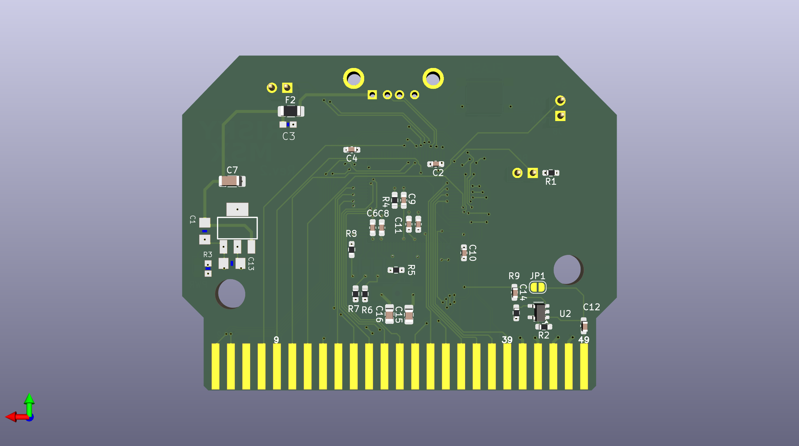](images/RISKYMSXCart-Rev2-back-render.png)
|-|-|
|RISKYMSX Rev 2 front render|RISKYMSX Rev 2 rear render|

#### Rev 1 (obsolete)

This is the initial revision of the RISKYMSX cartridge.

[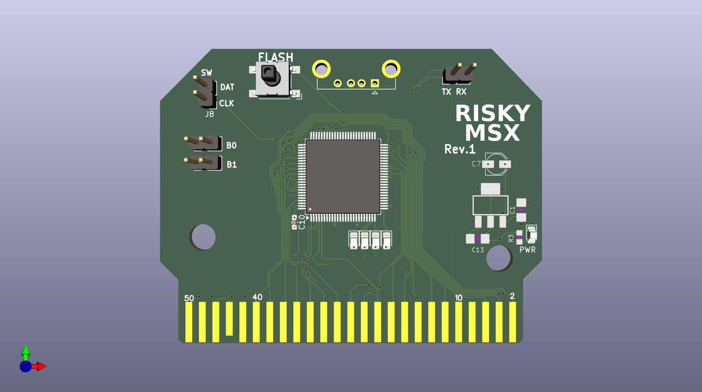](images/RISKYMSXCart-Rev1-front-render.png)|[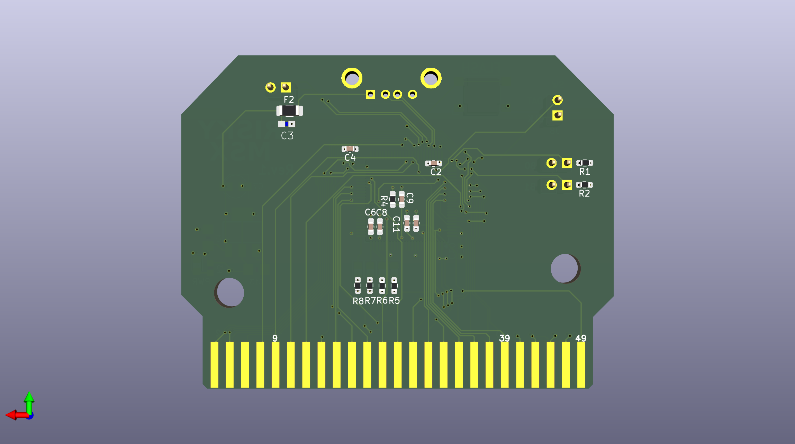](images/RISKYMSXCart-Rev1-back-render.png)
|-|-|
|RISKYMSX Rev 1 front render|RISKYMSX Rev 1 rear render|


## Firmware

The firmware implements two different modes of operation for the RISKYMSX cartridge:
* `Normal Mode`. In this mode a ROM cartridge is emulated according to the last ROM flashed using the `ROM Flashing Mode`.
* `ROM Flashing Mode`. In this mode a ROM can be flashed manually or automatically into the cartridge by using a FAT formatted USB pen drive.

### Automated releases

GitHub Actions builds the bootloader, firmware, and Nextor cartridge on pushes
and pull requests to `main`. Pushing a version tag matching
`firmware/User/version.h` (currently `v4.2.1`) automatically creates a GitHub
Release containing:

* Firmware `.bin` and `.hex` files, plus the `CART.NXT` Nextor cartridge image
* `Bootloader.bin`, the experimental custom bootloader image (not application firmware)
* A ZIP of the PCB Gerber and drill files
* `SHA256SUMS` checksums for the release files

Successful pushes to `main` also update the `latest-build` prerelease with
the same assets and the commit SHA, if the built commit is still the tip of
`main`. Its tag and assets are replaced on each update; older rolling builds
are not retained. If the current build fails, the previous release remains.
Versioned releases remain separate, and pull requests do not publish releases.

The BOM is not included in new release packages. Previously published releases
may contain an outdated BOM. Verify the current schematic BOM before ordering
parts.

Create and push a tag to publish a release:

```bash
git tag v4.2.1
git push origin v4.2.1
```


## Building a RISKYMSX cartridge

You will need good soldering skills and specific equipment to build a RISKYMSX cartridge.
As you probably saw on the Bill Of Materials, there are quite small SMD components like 0603 passives and a LQFP-100 package with 0.5mm pitch that need to be soldered.

> [!WARNING]
> If you are building new boards, please use the current available board revision.

### PCB

The PCB can be fabricated from the [rev 2.2 Gerber archive](board/gerbers/RISKYMSXv22.zip).
The [rev 2.1 archive](RiskyMSXv21PCB.zip) is retained for older boards.

### Suggested tools

These are example tools used during the manual building of the RISKYMSX cartridge:

* silicone heat-resistant mat (TE-616 400x290mm), to avoid burning your precious desk
* electronic microscope with 2 LEDs (KKmoon 3" LCD 10X-300X 3.0MP 1080P HDMI electronic digital video microscope), to be able to solder those small 0.5mm pitch pins
* temperature controlled soldering station (Yihua 908D), to make good soldering joints
* T-1C "horseshoe", T-I and T-1.6D soldering tips (900M series), use the best fitting one for each soldering job
* copper sponge, for soldering head cleaning
* flux (Mechanic UV80 flux paste), to help keep components in place and achieve good soldering joints
* solder (0.5mm, for hobby projects you may use 60% Sn / 40% Pb Flux 2% at your own risk)
* desoldering wick (2.5mm is fine), for correcting mistakes if you are human)

### Components and assembly

The [CSV BOM](RISKYMSXCart.csv) is generated from the current schematic, but
is not a verified shopping list or assembly guide. Check component values,
ratings, footprints, orientation, and population before ordering or assembly.
U2 is `CH32V303VCT6`; the schematic retains the existing CH32V307 library
symbol, so verify its pin assignments against the CH32V303 datasheet.
The [interactive BOM](board/bom/ibom.html) shows the current PCB and its
component positions. It is also not a verified shopping list.

To regenerate the CSV with KiCad 10 from the repository root:

```sh
kicad-cli sch export bom \
  --fields 'Reference,Value,Footprint,QUANTITY,DNP' \
  --labels 'Reference,Value,Footprint,Qty,DNP' \
  --group-by 'Value,Footprint,DNP' --ref-range-delimiter '' \
  -o RISKYMSXCart.csv board/RISKYMSXCart.kicad_sch
```

The `DNP` column records KiCad's do-not-populate status. The list includes the
MSX edge connector footprint, which is part of the PCB rather than a separate
component. KiCad's PCB DRC reports footprint-library warnings; review those
before fabrication.

To regenerate the interactive BOM, install the KiCad 10-compatible
[InteractiveHtmlBom](https://github.com/openscopeproject/InteractiveHtmlBom)
plugin and run it from PCB Editor, or use its command-line tool:

```sh
generate_interactive_bom --no-browser --dest-dir bom board/RISKYMSXCart.kicad_pcb
```

The interactive BOM is generated from PCB values; synchronize the PCB with the
schematic and check for mismatches before regenerating it.

### Building the firmware on Linux

> [!NOTE]
> These instructions have been validated using Ubuntu 24.04.2 LTS.

#### Cloning the RISKYMSX github repository

```bash
cd $HOME
git clone 'https://github.com/arkadiuszmakarenko/RISKYMSX.git'
```

This will clone the RISKYMSX github repository to the `RISKYMSX` directory under your home directory.


#### Installing the [MounRiverStudio IDE](http://www.mounriver.com)

1. Download the MounRiverStudio package for Linux

[http://www.mounriver.com/download](http://www.mounriver.com/download)

Choose the package in `tar.xz` format.

2. Uncompress the MounRiverStudio package into a known directory

For example this will uncompress the MounRiverStudio package into the IDE directory under your home directory.

```bash
export IDEDIR=$HOME/IDE
mkdir -p $IDEDIR && cd $IDEDIR
tar xJvf /path/to/MounRiverStudio_Linux_X64_V210.tar.xz
```

Once uncompressed, all package files are under the `MRS2` directory.

3. Setup the MounRiverStudio

You can follow the instructions described on the `README` file.
Alternatively, if you don't want to install library files system-wide you can follow these instructions:

* Change to the `MRS2/beforeinstall` directory

```bash
cd MRS2/beforeinstall
```

* Make a backup of the `start.sh` script file for reference

```bash
cp start.sh start.sh.orig
```

* Modify the `start.sh` script file.

Comment out the lines that install libraries and the line that gives world write access to all files under the `MRS-linux-x64` directory.
Leave as is the code that copies the udev rules for the WCH programmers and reloads them into udevadm.

```bash
#! /bin/bash
#echo  -e "\nCopy Libs"
#sudo cp -P ./lib*    /usr/lib
#echo  -e "Register new Libs"
#sudo ldconfig
echo "copy rules"
sudo cp ./50-wch.rules /etc/udev/rules.d
sudo cp ./60-openocd.rules  /etc/udev/rules.d
echo "Reload rules"
sudo udevadm control  --reload-rules

#chmod -R 777 ../MRS-linux-x64
chmod -R 750 ../MRS-linux-x64

echo -e "DONE"
```

* Run the modified `start.sh` script

```bash
chmod u+x start.sh
./start.sh
```

* Make the `chrome-sandbox` executable suid to root by changing the ownership of the file to root and setting the SUID bit.

This is required as the MounRiverStudio IDE is an Electron-based application that uses a sandbox approach.

```bash
cd ../MRS-linux-x64
sudo chown root chrome-sandbox
sudo chmod 4755 chrome-sandbox
```

#### Launching the MounRiverStudio IDE

If you installed the MounRiverStudio IDE under `$HOME/IDE`, use the following complete command line whenever you need to launch MounRiverStudio IDE specifying where to find the extra libraries needed.

```bash
cd $HOME/IDE/MRS2/MRS-linux-x64
LD_LIBRARY_PATH=$(readlink -f ../beforeinstall/) ./mounriver-studio\ 2
```

[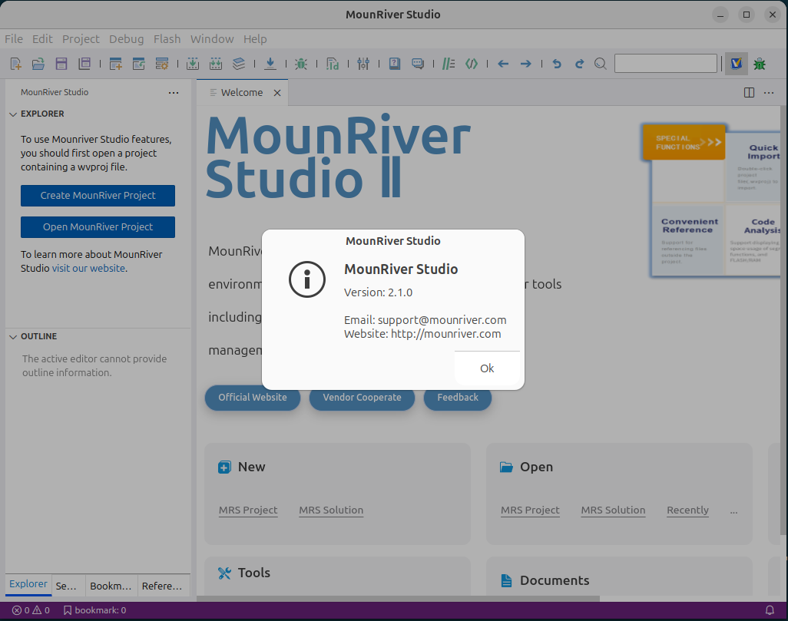](images/mounriverstudio-ide-about.png)


#### Generating the firmware file

1. After launching the MounRiverStudio IDE, open the RISKYMSXCART project file

`File | Open MounRiver Project`

**`/path/to/your/RISKYMSX/firmware/RISKYMSXCART.wvproj`**

The project file is under the `firmware` directory on the cloned github repository.

2. Build the project

`Project | Build Project`

[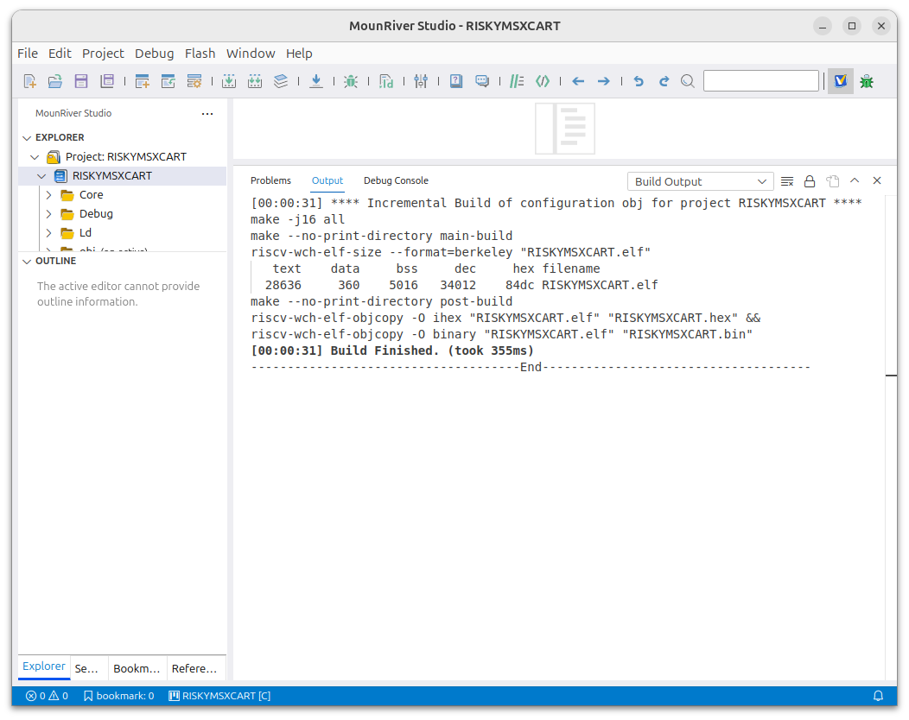](images/mounriverstudio-ide-build-project.png)


#### Generating the firmware file from the command line

As an alternative to the MounRiverStudio IDE, the firmware can be built and flashed directly from the command line using GNU `make`.

Requirements:

* GNU `make`
* A RISC-V toolchain. The Makefile auto-detects, in order:
  1. A locally installed `MRS_Toolchain_Linux_x64_V210/RISC-V Embedded GCC12` at the repository root (not shipped in the repo)
  2. `riscv-wch-elf-gcc` on `PATH` (the same compiler MounRiver uses)
  3. `riscv-none-embed-gcc` on `PATH` (xPack)
  4. `riscv64-unknown-elf-gcc` on `PATH` (system package)
* For `make flash`: OpenOCD with WCH-Link support (the Makefile uses the WCH version from the local MounRiver toolchain when available)
* For rebuilding `CART.NXT`: the .NET runtime needed by the vendored N80 assembler

The default build also attempts to build Nextor and copy it to `build/CART.NXT`.
It prints a warning rather than failing if the Nextor build fails; check the
output and do not assume an existing `CART.NXT` is fresh.

#### Building all images from the repository root

Run `make` from the repository root to build the bootloader, firmware, and
Nextor cartridge. The output files are placed in the root:
`Bootloader.bin`, `RISKYMSXCART.bin`, `RISKYMSXCART.hex`, and `CART.NXT`.
Individual builds are available with `make bootloader`, `make firmware`, or
`make nextor`; `make clean` removes the local firmware and bootloader outputs
and build directories. It leaves the tracked `CART.NXT` release image in place.

Build the firmware:

```bash
cd firmware
make            # produces build/RISKYMSXCART.{elf,bin,hex,map}
make size       # show program/data sizes
make clean      # remove build artifacts
```

Build and program the chip with OpenOCD and a WCH-LinkE:

```bash
make flash
```

You can override the toolchain explicitly, for example to force a clean build with the xPack toolchain:

```bash
make TOOLCHAIN_DIR=/opt/xpack PREFIX=riscv-none-embed- clean all
```


#### Programming the firmware

Firmware programming changes the MCU application, whereas ROM flashing in the
cartridge menu only selects an MSX ROM. Use a WCH-LinkE for initial programming
and recovery. The optional custom bootloader offers a different, experimental
way to update the application from an MSX and USB stick after installation.

> [!WARNING]
> On rev 2.2 the CH217K switches the USB host VBUS. A USB cable connected to
> a PC is not a suitable source of cartridge power. The old USB ISP
> cable-only instructions do not apply to this revision. USB ISP with an
> independently powered board has not been validated here.
>
> Use a properly powered target and a common ground with the WCH-Link. A
> specific standalone power connection for rev 2.2 has not yet been
> validated; consult the schematic and verify the supply, voltage and
> connections before programming. Do not bypass the switch or connect
> multiple power sources based on the old instructions.

##### Programming the application with WCH-LinkE

1. With power off, connect WCH-LinkE SWCLK/TCK to J8 CLK, SWDIO/TMS to
   J8 DAT, and the programmer ground to target ground. Follow the
   [WCH-Link manual](https://www.wch-ic.com/downloads/WCH-LinkUserManual_PDF.html)
   for the programmer's target-voltage requirements and RISC-V mode.
2. Provide the target with a verified supply, connect the WCH-LinkE to the PC
   and confirm the cartridge is powered. The target power arrangement must be
   verified for the board revision; it is not supplied by the USB host port.
3. Use `make flash` in `firmware/`, or select the built
   `firmware/obj/RISKYMSXCART.hex` in MounRiverStudio under
   `Flash | Download Configuration` and use `Flash | Download`. The
   command-line build produces `firmware/build/RISKYMSXCART.hex` instead.
4. Verify the operation with the programmer. Power down before disconnecting
   wires or inserting or removing the cartridge. Keep B0 open for normal boot.

##### Updating with the custom bootloader (experimental)

The [custom bootloader](bootloader/README.md) is not the CH32V303 factory ISP
bootloader. It occupies the 28 KiB system boot flash and must first be
installed using a WCH-Link and a compatible `minichlink`; it is not installed
by programming the normal application firmware.

> [!CAUTION]
> Replacing the factory bootloader is untested and hardware-dependent. It
> removes factory USB/USART ISP while installed, and a failed write or unusable
> backup can prevent recovery. Back up the system boot region first, keep the
> WCH-Link available, and read the complete
> [installation and recovery instructions](bootloader/README.md) before
> proceeding. Flash programming and MSX bus timing need hardware validation.

After the custom bootloader has been installed and validated:

1. Copy the application binary to the root of a FAT-formatted USB stick as
   `RISKYMSXCART.BIN`. The bootloader also checks `FIRMWARE.BIN` and
   `UPDATE.BIN`, in that order. Release binaries with a version in their name
   must be renamed.
2. With the MSX powered off, close B0, insert the cartridge and USB stick, and
   power on the MSX. B0 selects system boot; the cartridge is powered by the
   MSX, not by the USB stick.
3. Follow the MSX screen: press Return to program or Esc to cancel. Wait for
   programming and read-back verification to finish.
4. Power off the MSX, open B0, then power on again to run the application.
   Never remove or insert the cartridge while the MSX is powered on.


## Cartridge Operation

The RISKYMSX cartridge can operate in two different modes once programmed with the RISKYMSX firmware.

Make sure the MSX computer is powered off before inserting or removing the RISKYMSX cartridge or any other cartridge.

> [!WARNING]
> Leave DAT/CLK and RX/TX unconnected for ordinary cartridge operation. B0
> must be open for normal boot; closing it selects system boot for the
> optional custom bootloader.


### Normal Mode

In `Normal mode` the RISKYMSX cartridge behaves as a ROM cartridge once a ROM has been flashed.

Just insert the RISKYMSX cartridge and enjoy the already flashed ROM.

### ROM Flashing Mode

In `ROM Flashing Mode` a ROM file residing in a USB drive can be flashed to the RISKYMSX cartridge for later use in `Normal Mode`.

1. Make sure the MSX computer is powered off

2. Insert the RISKYMSX cartridge

3. Press and hold the `GRAPH` key on the MSX computer keyboard and power on the MSX computer.

You can release the `GRAPH` key once you see the Flash LED turn on.

[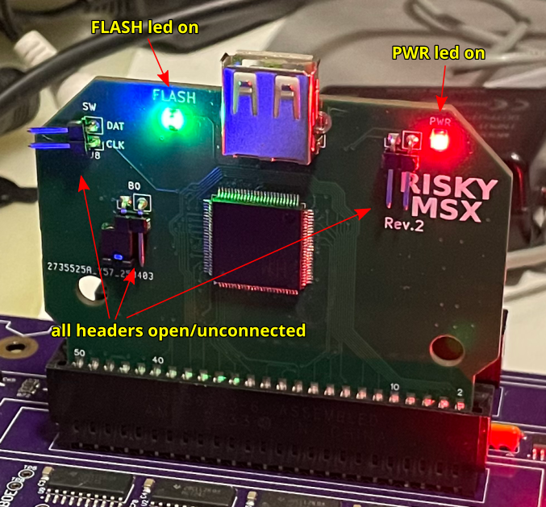](images/riskymsx-in-flashing-rom-mode.png)

4. If no USB drive is connected to the RISKYMSX cartridge, the "Insert USB" screen will appear.

[](images/firmware-insert-usb-screen.png)

You will need to connect a FAT-formatted USB drive to continue the ROM flashing procedure.

Once that is done, the RISKYMSX will try first to auto-flash a ROM before switching to manually flashing ROMs.

#### Auto-flashing ROMs

The RISKYMSX firmware will automatically flash the first file found on the root directory of the connected FAT-formatted USB drive matching one of the special filenames for ROM auto-flashing, according to the following table. A mapper will be automatically assigned based on the filename detected.

 | Mapper               | filename         | 
 |   :-----------:      | :--------------: | 
 | 16KB ROM             | cart.r16         | 
 | 32KB ROM             | cart.r32         | 
 | 48KB / 64KB ROM      | cart.r48         |
 | KONAMI without SCC   | cart.ko4         |
 | KONAMI with SCC(EN)  | cart.ko5         |
 | KONAMI with SCC(DIS) | cart.kd5         |
 | ASCII8k              | cart.a8k         | 
 | ASCII16k             | cart.a16         | 
 | NEO16                | cart.n16         | 
 | NEO8                 | cart.n8k         | 

So for example, to automatically flash F1SPIRIT.ROM, which is a KONAMI with SCC game, the F1SPIRIT.ROM file can be copied to the root of the USB drive using the filename **cart.ko5**, and then follow the mentioned procedure.

[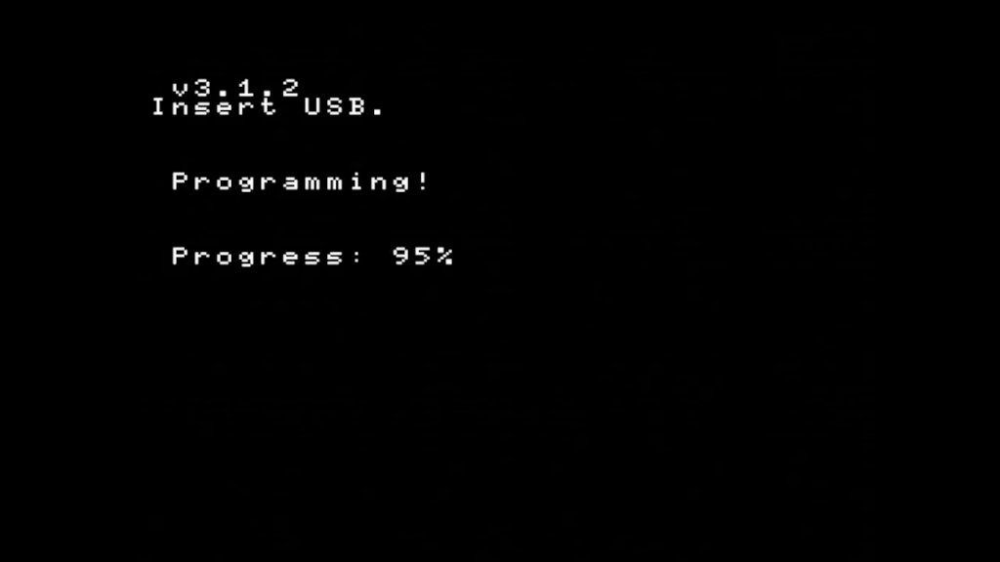](images/riskymsx-in-auto-flashing-rom-mode.png)

After flashing the ROM file, the RISKYMSX will automatically reboot the MSX computer and the ROM will load.

Note that if several files matching the auto-flashing filenames are found on the USB drive, only the file that causes the first match in the above table order will be flashed.

#### Manually flashing ROMs

If the connected FAT-formatted USB drive contains no files matching the auto-flashing filenames, the RISKYMSX firmware will display the interactive ROM flashing menu.

[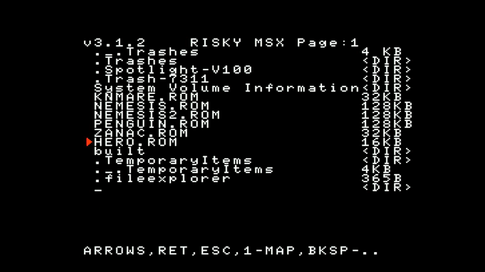](images/firmware-manually-selecting-file-screen.png)

Use the following keys to interact with the file menu screen:
* `Up`, `Down`: move up or down the red arrow cursor across the available files in the current page
* `Right`: go to the next page (if more files are available to list)
* `Left`: go to the previous page (if any pagination was done before)
* `Return`: select a file for flashing
* `Esc`: go to the previous screen, or reload the file list on the root directory
* `1`: show the current flashed ROM file and mapper type, and optionally change the mapper type
* `N`: flash `CART.NXT` from the USB root as a Nextor cartridge
* `Backspace`: go to the previous directory level on the file menu

Useful tips:
* The bottom of the file menu screen shows the keys that are available to use at any moment
* Files and directories are listed alphabetically (directories first, upper/lowercase ignored), regardless of how many files a folder contains
* You can always hot-swap the USB drive while in the file menu, and once a new USB drive is connected you need to press `Esc` to refresh the file contents
* DO NOT navigate or select files while you have disconnected a USB drive without pressing `Esc` first
* Pressing `1` and choosing `SCC only (no ROM)` stores only the mapper setting in the config area (no ROM data is flashed). The cart then emulates just the SCC (0x9000-0x98FF, triggered by CS2 rather than SLTSL) on every boot unless GRAPH is held to enter the terminal
* If you flash a ROM with the wrong mapper type, you can change the mapper type easily, without reflashing the ROM again, by pressing `1` (the mapper type detected from the flashed ROM content is pre-selected there too)

When a ROM file is selected by pressing the `Return` key the mapper selection screen shows up. The mapper type is auto-detected from the ROM content and pre-selected (shown as `Detected:`), so pressing `Return` again flashes the ROM with the detected mapper. You can still move the cursor to pick a different mapper type before pressing `Return`.

[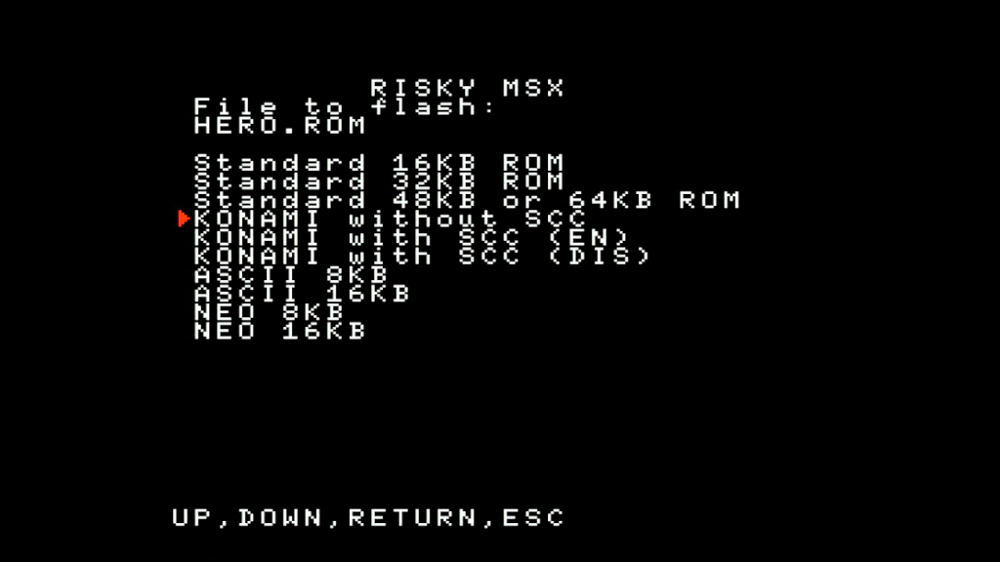](images/firmware-manually-selecting-mapper-type-screen.png)

Select the correct mapper type for the selected ROM file and press `Return` to start flashing the ROM.

[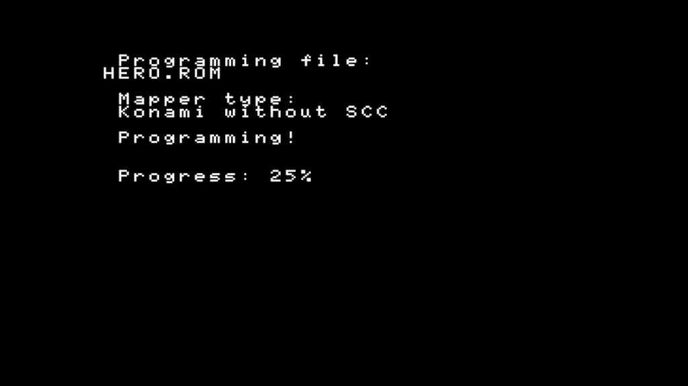](images/firmware-manually-flashing-rom-screen.png)

Once the flashing process finishes the RISKYMSX firmware will reboot the MSX computer and the flashed ROM will load.

#### Nextor USB disk

Nextor 3 turns the cartridge into a USB mass-storage disk controller for
MSX-DOS. The cartridge exposes one USB device to Nextor, which maps its
compatible partitions to MSX drives.

**Minimum for the Nextor 3 DOS environment:**

* An MSX with at least 128 KiB of mapped RAM, a RISKYMSX cartridge with the
  current firmware, and the Nextor cartridge image `CART.NXT`.
* A USB mass-storage device with 512-byte sectors, an MBR partition table
  (not GPT), and a FAT16 or FAT12 partition. FAT16 is recommended. Nextor
  does **not** support FAT32, exFAT, or NTFS.
* Stable Nextor 3.0 `NEXTOR.SYS` and `COMMAND3.COM` in the root of the
  partition used to boot.

Without 128 KiB of mapped RAM, Nextor falls back to MSX-DOS 1 mode; that
mode requires a FAT12 partition with at most three sectors per FAT and, for
the DOS prompt, at least 64 KiB of RAM plus the MSX-DOS 1 system files. See the
[Nextor user manual](https://konamiman.github.io/Nextor/Nextor_3.0_User_Manual.html)
for details.

**Enable and boot Nextor:**

1. Get `CART.NXT` from a [RISKYMSX release](https://github.com/arkadiuszmakarenko/RISKYMSX/releases)
   or run `make nextor` at the repository root.
2. Copy `CART.NXT` to the root of a FAT-formatted USB stick for flashing.
   Enter ROM flashing mode by holding `GRAPH` at startup, and press `N` in
   the file menu. This replaces the currently flashed cartridge ROM with
   Nextor; it does not replace the MCU firmware.
3. Prepare a separate Nextor USB disk as described above. Download
   [Nextor 3.0 tools.zip](https://github.com/Konamiman/Nextor/releases/tag/tools-disk-image-and-zip-for-Nextor-3.0),
   extract it, and copy `NEXTOR.SYS` and `COMMAND3.COM` to the boot
   partition's root. The `TOOLS` and `HELP` directories are optional but
   useful; copy them as well if desired.
4. Insert the Nextor disk and restart the MSX normally, without holding
   `GRAPH`. The flashed Nextor kernel loads the system files from the disk.

Nextor maps active FAT12/16 partitions at boot; if none is active, it uses the
first suitable partition. Partitioning or formatting erases data, so back up
the USB device first. For partitioning and other commands, see the
[Nextor getting started guide](https://konamiman.github.io/Nextor/Nextor_3.0_Getting_Started_Guide.html)
and [Nextor downloads](https://konamiman.github.io/Nextor/releases/). The
kernel and system files must be compatible; this build uses stable Nextor 3.0
([Nextor build](NextorDriver/Makefile)).

## General troubleshooting

* If no LEDs light at power-up, check the power rails and inspect for shorts.
* On rev 2.2, a rapidly flashing activity LED can indicate a CH217K
  over-current or over-temperature fault. The firmware disables USB power and
  latches the fault until reset. Remove the cause before resetting.
* If a ROM can be programmed but the MSX cannot load it, inspect the address,
  data and bus connections and their solder joints.


## Compatibility

The RISKYMSX cartridge has been tested on the following MSX computers:

| **Model**                | **RISKYMSX**              |
|--------------------------|---------------------------|
| Sony MSX HB-101P         |          OK               |
| Sony MSX HB-501F         |          OK               |
| Toshiba MSX HX-10        |          OK               |
| Philips MSX2 VG-8235     |          OK               |
| Panasonic MSX2+ FS-A1WSX |          OK               |
| Omega MSX2+              |          OK               |
| Tides Rider MSX2+        |          OK               |
| TFMSX Rev 1 MSX2+        |          OK               |
| TFMSX Rev 2 MSX2+        |          OK               |
| MSXVR                    |          `NOK`            |

Other MSX compatible computers will probably work too, but have not been specifically tested.


## Enclosures

### Acrylic Enclosure

You can complete your RISKYMSX cartridge with an [acrylic enclosure](https://github.com/herraa1/msx-riskymsx-enclosure) suitable for all RISKYMSX cartridge board revisions.

[](https://github.com/herraa1/msx-riskymsx-enclosure)


### 3D Printed Enclosure

Another option for closing your RISKY MSX Cartridge is following project  [Enclosure](https://github.com/rafaelan00/RISKYMSX-Enclosure)


## Acknowledgments

The following people contributed to this project and supported me with technical aspects of this project.
* Terrible Fire
* cnlohr 
* NYYRIKKI
* Aoineko
* BG Ollie
* MadHacker

Testing team:
* PhilC
* Higgy
* ahmsx
* Hee-Bong An
  
Thank you very much for your support.
